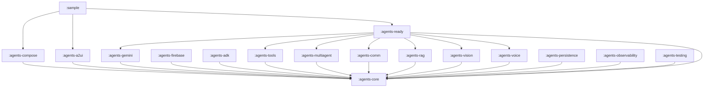

# Android AI Agents SDK — Module Architecture & Team Division

Oct 2, 2026 · Maintainer: @Anand

## Purpose & the golden rule

The SDK is built as many small, independent Gradle modules so separate teams can own, build, and ship pieces in parallel — and every PR touches one module without colliding with another.

**Why multi-module:**

- Parallel teams — each team owns a module and works without waiting on others.
- Faster builds — only the changed module and its dependents rebuild.
- Clear ownership — one module, one owning team, one set of reviewers.
- Lean consumers — an app depends only on the modules it actually uses.
- Future-proof — a new capability arrives as a *new* module, without touching existing ones.

**How independent PRs stay conflict-free:** a change lives inside one module's folder; CI builds and tests just that module; its owners review it. Because modules do not reach into each other, two teams almost never edit the same files — so PRs merge cleanly in any order.

**The golden dependency rule (the whole system rests on this):**

- `:agents-core` depends on nothing but Kotlin + coroutines.
- Every other module depends on `:agents-core` and **never on a sibling**.
- Providers, capabilities, UI, and storage all talk through interfaces defined in core.
- Only `:agents-ready` and `:sample` are allowed to compose several modules together.

If two modules need to share something, that something becomes an interface in `:agents-core` — not a dependency between the two. This single rule is what keeps modules independent and their PRs mergeable.

## Module map

Seventeen focused modules across five layers. Not all are built at once — see Roadmap for phasing.

| Module | Scope (one line) | Layer |
| --- | --- | --- |
| `:agents-core` | Core abstractions + contracts: `Agent`, `LlmClient`, `AgentConfig`, DSL, **agent-bus & UI contracts** | Foundation |
| `:agents-gemini` | Gemini provider over the REST API (dev key mode) | Provider |
| `:agents-firebase` | Firebase AI Logic provider (production key mode) | Provider |
| `:agents-adk` | Bridge to `google/adk-kotlin` — ADK tools, multi-agent, on-device Nano | Provider |
| `:agents-tools` | Function-calling: define tools and a tool registry | Capability |
| `:agents-multiagent` | Orchestration: router agent, sequential & parallel pipelines | Capability |
| `:agents-comm` | **Agent-to-agent communication**: message bus + registry so agents call each other, decoupled | Capability |
| `:agents-rag` | Retrieval, embeddings, and a vector store for `RagAgent` | Capability |
| `:agents-voice` | Speech-to-text and text-to-speech | Capability |
| `:agents-vision` | Image and screenshot understanding | Capability |
| `:agents-ready` | Ready-made agents: Chat, Summarizer, Translator, and more | Agents |
| `:agents-compose` | Jetpack Compose UI components (chat screen, input bar) | UI |
| `:agents-a2ui` | **Agent-to-UI**: agents emit UI specs that Jetpack Compose renders dynamically | UI |
| `:agents-persistence` | Session and history storage (Room / DataStore) | Platform |
| `:agents-observability` | Logging, tracing, and telemetry hooks | Platform |
| `:agents-testing` | Test utilities and fakes (e.g. `FakeLlmClient`) | Platform |
| `:sample` | Demo app showcasing every feature | App |

## Dependency graph

Everything points down to `:agents-core`. No arrow ever goes sideways between siblings.



**The rules the graph enforces:**

- `:agents-core` depends on nothing but Kotlin + coroutines — it is the stable contract.
- Providers (`gemini`, `firebase`, `adk`), capabilities (`tools`, `multiagent`, `rag`, `vision`, `voice`), and platform modules (`persistence`, `observability`, `testing`) depend **only on core**.
- `:agents-ready` is the one place that composes providers + capabilities into usable agents.
- `:agents-compose` depends on core (and `:agents-ready` only in its sample/preview code).
- `:sample` sits on top and may depend on anything.
- No sibling-to-sibling edge, ever. Shared needs become an interface in core.

## Agent-to-Agent communication & Agent-to-UI

Two cross-cutting capabilities, both designed the same way so modules stay independent: **the contract lives in `:agents-core`, the implementation lives in its own module, and consumers depend only on the core contract** (dependency inversion). An agent never holds a hard reference to another agent or to a UI toolkit.

### Agent-to-agent (A2A) communication — `:agents-comm`

When one agent needs another (say `ChatAgent` delegates a phrase to `TranslatorAgent`), a direct reference would couple their modules. Instead they talk through a communication layer.

- `:agents-core` defines the contract: `AgentMessage`, `AgentRef` (address), `AgentBus` (send / subscribe), and `AgentRegistry` (register an agent under a name or capability).
- `:agents-comm` provides the default `InProcessAgentBus` + registry.
- Any agent sends to another **by name or capability** through the bus — no compile-time dependency on that agent's module.

```kotlin
// Register agents once (e.g. in the app)
registry.register("translator", TranslatorAgent(apiKey))

// Any agent reaches another through the bus - no direct reference
val reply = bus.send(AgentMessage(to = "translator", text = "Translate: Hello"))
```

This is what makes "any agent can use another agent" easy and decoupled, and it maps cleanly onto ADK's A2A later via `:agents-adk`.

### Agent-to-UI (A2UI) — `:agents-a2ui`

Agents should be able to return *UI*, not just text — a card, a form, buttons, a list — and have Jetpack Compose render it.

- `:agents-core` defines the UI contract: `UiComponent` (sealed: `Text`, `Card`, `Button`, `Input`, `ListView`, …) and `UiEvent` (what the user did).
- An agent emits `UiComponent`s; `:agents-a2ui` renders them in Compose and routes `UiEvent`s back to the agent.
- Because the contract is in core, agents stay UI-framework-agnostic — the same agent output could render elsewhere tomorrow.

```kotlin
@Composable
fun AgentScreen(agent: Agent) {
    val ui by agent.uiState.collectAsState()
    A2Ui(components = ui) { event -> agent.onUiEvent(event) }
}
```

**`:agents-compose` vs `:agents-a2ui`:** `:agents-compose` is fixed, hand-written chat UI; `:agents-a2ui` is dynamic, agent-driven (generative) UI. Both depend only on `:agents-core`.

## Module scope in detail

| Module | Responsibility | Key public API | Depends on | Phase |
| --- | --- | --- | --- | --- |
| `:agents-core` | The contract every module builds on | `Agent`, `LlmClient`, `AgentConfig`, DSL, `AgentBus`, `UiComponent` | — | v0.1 |
| `:agents-gemini` | Call Gemini via REST with an API key | `GeminiClient : LlmClient` | core | v0.1 |
| `:agents-firebase` | Production key mode via Firebase AI Logic | `FirebaseLlmClient : LlmClient` | core | v0.5 |
| `:agents-adk` | ADK-backed tools, multi-agent, on-device | `AdkAgent`, `AdkToolBridge` | core | v0.5 |
| `:agents-tools` | Define functions agents can call | `Tool`, `ToolRegistry`, `@AgentTool` | core | v0.2 |
| `:agents-multiagent` | Route and chain agents | `AgentPipeline`, `ParallelAgentGroup`, `RouterAgent`, `multiAgent` | core | v0.4 |
| `:agents-comm` | Let agents talk without direct references | `InProcessAgentBus`, `AgentRegistry` (impl of core's `AgentBus`) | core | v0.4 |
| `:agents-rag` | Retrieval over your documents | `VectorStore`, `Embedder`, `RagAgent` | core | v0.4 |
| `:agents-voice` | Speech in and out | `SpeechToText`, `TextToSpeech`, `VoiceAgent` | core | v1.0 |
| `:agents-vision` | Understand images | `VisionAgent` | core | v0.4 |
| `:agents-ready` | Drop-in agents with good defaults | `ChatAgent`, `SummarizerAgent`, `TranslatorAgent` | core + providers/capabilities | v0.1+ |
| `:agents-compose` | Compose UI for agents | `AgentChatScreen`, `MessageList`, `AgentInputBar` | core | v0.3 |
| `:agents-a2ui` | Render agent-emitted UI in Compose | `A2Ui`, renders core's `UiComponent` / `UiEvent` | core | v0.5 |
| `:agents-persistence` | Save sessions and history | `SessionStore`, `RoomSessionStore` | core | v0.3 |
| `:agents-observability` | See what agents are doing | `AgentLogger`, `Tracer` | core | v0.2 |
| `:agents-testing` | Help contributors test | `FakeLlmClient`, `TestAgent`, assertions | core | v0.2 |
| `:sample` | Show the SDK in a real app | — (app) | everything | v0.1+ |

Each module keeps its public API small and marks internals `internal`. The public surface of `:agents-core` is the one true contract — treat it as frozen and change it only through the Core team.

## Team division & ownership

Group the modules into small squads. Each squad owns its modules end to end — code, tests, and reviews.

| Squad | Owns | Focus |
| --- | --- | --- |
| Core | `:agents-core`, `:agents-tools`, `:agents-multiagent`, `:agents-comm` | The contract, orchestration & agent messaging |
| Providers | `:agents-gemini`, `:agents-firebase`, `:agents-adk` | Talking to the models |
| Agents | `:agents-ready`, `:agents-rag`, `:agents-vision`, `:agents-voice` | Ready-made agents and capabilities |
| UX | `:agents-compose`, `:agents-a2ui`, `:sample` | UI, generative UI, and the demo app |
| Platform | `:agents-persistence`, `:agents-observability`, `:agents-testing`, CI | Storage, insight, and tooling |

**CODEOWNERS** makes this automatic — a `.github/CODEOWNERS` file maps each module path to its squad, so GitHub requests the right reviewers on every PR:

```
/agents-core/           @AI-Mobile-Coders/core
/agents-gemini/         @AI-Mobile-Coders/providers
/agents-ready/          @AI-Mobile-Coders/agents
/agents-compose/        @AI-Mobile-Coders/ux
/agents-persistence/    @AI-Mobile-Coders/platform
```

**Why PRs stay independent:** a feature PR edits files inside one module folder only. Its squad reviews it, CI builds that module, and it merges on its own schedule. The single cross-cutting event is a change to `:agents-core`'s public API — that needs Core-squad review and a version bump, because everyone depends on it. Everything else is parallel and conflict-free.

## Gradle & build conventions

Shared conventions keep fifteen modules consistent and cheap to maintain.

- **One version catalog** — all dependency versions live in `gradle/libs.versions.toml`. No module hard-codes a version. One bump updates everyone.
- **Convention plugins (`build-logic`)** — a `build-logic` composite build holds shared setup (Android library config, Kotlin options, publishing) as plugins like `agents.android.library`. Each module's `build.gradle.kts` then stays a few lines: apply the convention, declare its dependencies. One place to change compileSdk, JVM target, or lint for all modules.
- **Naming** — module `:agents-<name>`, package `com.aimobilecoders.agents.<name>`, namespace matching. Predictable and greppable.
- **Maven coordinates** — group `com.aimobilecoders.agents`, artifact = module name:

```kotlin
implementation("com.aimobilecoders.agents:agents-core:<version>")
implementation("com.aimobilecoders.agents:agents-ready:<version>")
```

- **API stability** — run the Kotlin binary-compatibility validator on `:agents-core` so its public API cannot change by accident.
- **Per-module CI** — CI builds and tests only the modules a PR touches, keeping checks fast.

A module's `build.gradle.kts` should read like this:

```kotlin
plugins {
    id("agents.android.library")   // shared convention
}

dependencies {
    implementation(project(":agents-core"))   // never a sibling
    implementation(libs.kotlinx.coroutines.android)
}
```

## Roadmap / phasing

Modules land in thin slices. A module is only started when its dependencies exist and a squad can own it.

| Version | Modules added | Outcome |
| --- | --- | --- |
| v0.1 | `:agents-core`, `:agents-gemini`, `:agents-ready` (Chat), `:sample` | A working `ChatAgent` end to end |
| v0.2 | `:agents-tools`, `:agents-observability`, `:agents-testing` + more ready agents | Tool-calling, logging, and testable agents |
| v0.3 | `:agents-compose`, `:agents-persistence` | Drop-in chat UI with saved history |
| v0.4 | `:agents-multiagent`, `:agents-comm`, `:agents-rag`, `:agents-vision` | Multi-agent apps, agent messaging, and retrieval |
| v0.5 | `:agents-firebase`, `:agents-adk`, `:agents-a2ui` | Production key mode, ADK, and generative UI |
| v1.0 | `:agents-voice` + hardening | Stable API, full catalog, published to Maven Central |

> Note: `:agents-core`, `:agents-gemini`, `:agents-ready` and `:sample` already exist in the repo as the v0.1 scaffold. The rest are created as their phase begins.

## Adding a new module (future-proofing)

When a new capability is ready, it arrives as a new module — existing code is never touched. The checklist:

1. Create an **Android Library** module `:agents-<name>`, package `com.aimobilecoders.agents.<name>`.
2. Apply the shared convention plugin (`id("agents.android.library")`).
3. Add **only** `implementation(project(":agents-core"))` — never depend on a sibling. If you need something from another module, lift its interface into core.
4. Keep the public API small; mark everything else `internal`.
5. Add tests using `:agents-testing` fakes.
6. Add a `CODEOWNERS` line for the owning squad.
7. Register Maven coordinates and include the module in publishing.
8. Document it in this doc's Module map and in the README.
9. If it is user-facing, wire a demo into `:sample`.

Follow these nine steps and the SDK scales to dozens of modules without the architecture ever degrading — that is what keeps it maintainable for the long term.

---

*Related: see the project vision and overview and CONTRIBUTING.md.*
